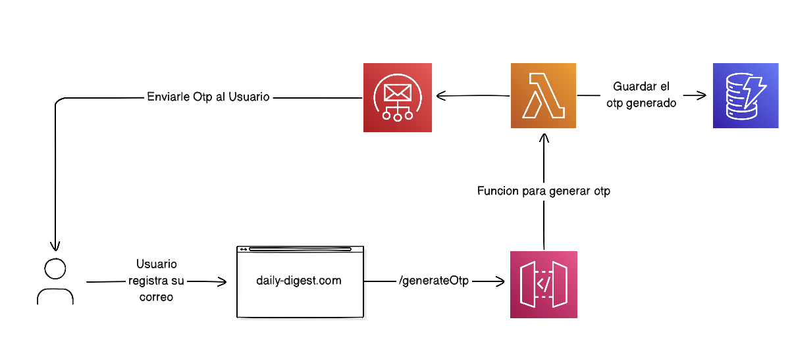
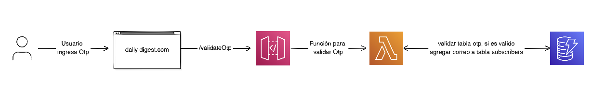
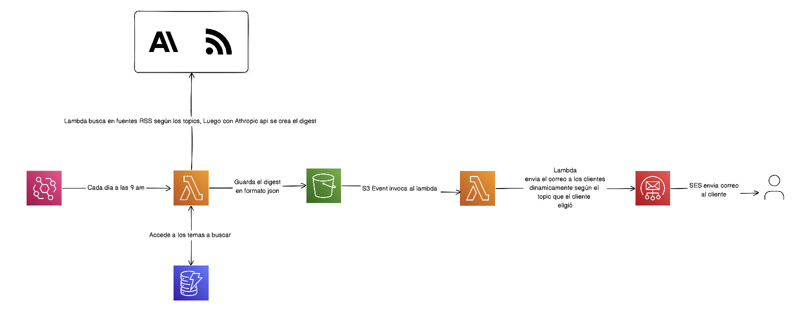

# Daily Tech News


Frontend de suscripción a un resumen diario de noticias tecnológicas. El usuario elige sus temas de interés, verifica su correo con un OTP y queda suscrito para recibir el digest cada mañana a las 9:00 AM.

El backend corre íntegramente en AWS y está definido como IaC en `terraform/`.

## Qué hace

1. El usuario elige uno o más temas: **Cloud**, **IA**, **Ciberseguridad**, **Development**
2. Ingresa su correo y recibe un código OTP de 6 dígitos vía SES
3. Verifica el código y confirma la suscripción
4. Cada día a las 9:00 AM (hora de Panamá) el backend genera el digest con Claude y lo envía por correo

## Arquitectura

```
Browser → Next.js proxy → API Gateway → Lambda (OTP / subscribers)
                                        DynamoDB (otps, subscribers)

EventBridge (cron 9 AM) → generateDigest → S3
                          S3 event        → sendDigestEmail → SES → subscribers
```

### Flujos detallados

**Suscripción / OTP**





**Envío del digest diario**



## Stack

| Capa | Tecnología |
|---|---|
| Frontend | Next.js 16, React 19, Tailwind CSS 4 |
| Backend | AWS Lambda (Node.js 22.x), API Gateway (REST) |
| Base de datos | DynamoDB (PAY_PER_REQUEST) |
| Email | Amazon SES |
| Almacenamiento | S3 (digest JSON) |
| Scheduler | EventBridge (cron) |
| IA | Anthropic Claude (generación del digest) |
| IaC | Terraform ≥ 1.5 |

## Desarrollo local

```bash
# Instalar dependencias
pnpm install

# Copiar variables de entorno
cp .env.example .env
# Editar .env con los valores reales

# Iniciar servidor de desarrollo
pnpm dev
```

Las variables necesarias están documentadas en `.env.example`.

## Infraestructura (Terraform)

Toda la infra de AWS está en `terraform/`. Usa módulos separados por servicio:

```
terraform/
├── main.tf              # Provider, backend S3, módulos, notificación S3
├── variables.tf         # Variables globales
├── outputs.tf           # API URL + key de salida
├── terraform.tfvars.example
└── modules/
    ├── dynamodb/        # Tablas Otp-daily-digest y subscribers
    ├── s3/              # Bucket de digests (versionado, SSE, acceso privado)
    ├── lambda/          # 6 funciones + IAM roles con mínimos permisos
    ├── api_gateway/     # REST API con API key, rutas POST /api/*
    └── eventbridge/     # Regla cron 9 AM Panamá → generateDigest
```

### Prerrequisitos

- [Terraform](https://developer.hashicorp.com/terraform/install) ≥ 1.5
- AWS CLI configurado (`aws configure`)
- Email verificado en Amazon SES

### Deploy

```bash
cd terraform

# Copiar y completar variables
cp terraform.tfvars.example terraform.tfvars
# Editar terraform.tfvars con tus valores

# Inicializar proveedores
terraform init

# Revisar cambios
terraform plan -var-file="terraform.tfvars"

# Aplicar
terraform apply -var-file="terraform.tfvars"
```

Al finalizar, `terraform output api_gateway_url` y `terraform output -raw api_gateway_key` dan los valores para el `.env` del frontend.

### Variables requeridas

| Variable | Descripción |
|---|---|
| `ses_sender_email` | Email verificado en SES para envíos |
| `allowed_origin` | URL del frontend (CORS headers de Lambdas) |
| `unsubscribe_base_url` | URL base para links en los correos |
| `anthropic_api_key` | API key de Anthropic para Claude |

## Estructura del proyecto

```
src/
├── app/
│   ├── page.tsx                    # Flujo principal (correo → OTP → éxito)
│   ├── unsubscribe/                # Baja de suscripción (?id=...&email=...)
│   ├── terminos-de-uso/
│   └── politica-de-privacidad/
├── aws/lambda/                     # Código fuente de las 6 Lambda functions
│   ├── generateOtp.js
│   ├── validateOtp.js
│   ├── validateActiveSubscriber.js
│   ├── unsubscribe.js
│   ├── generateDigest.js
│   └── sendDigestEmail.js
├── components/
│   ├── auth/                       # EmailStep, OTPStep, SuccessStep
│   └── legal/
└── lib/
    └── topics.ts

docs/
└── architecture/
    ├── diagrams/                   # Diagramas de flujo (PNG)
    └── decisions/                  # ADRs

terraform/                          # IaC — infraestructura AWS completa
```

## ADRs

Decisiones de diseño en `docs/architecture/decisions/`:

- **ADR-001** — Por qué SES para el envío de OTP
- **ADR-002** — Por qué DynamoDB para almacenar el OTP
- **ADR-003** — Lambda directo a SES vs SNS fanout para el digest diario

## Páginas

- `/` — Flujo de suscripción
- `/unsubscribe?id={id}&email={email}` — Cancelación de suscripción (enlace del correo)
- `/terminos-de-uso`
- `/politica-de-privacidad`
